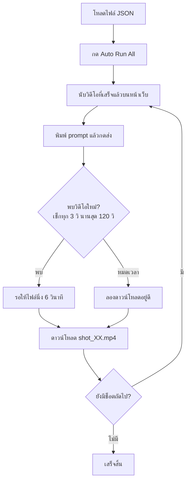

# 🎬 Meta AI Batch Video

> Chrome Extension (Manifest V3) ที่ทำหน้าที่เหมือน **"หุ่นยนต์พนักงานสั่งงาน Meta AI"** ช่วยผลิตคลิปวิดีโอดิบทีละหลายช็อตบน [meta.ai](https://www.meta.ai) โดยอัตโนมัติ ตั้งแต่พิมพ์ prompt, รอวิดีโอเรนเดอร์เสร็จ ไปจนถึงดาวน์โหลดและตั้งชื่อไฟล์ให้ (`shot_01.mp4`, `shot_02.mp4`, …) ไม่ต้องนั่งก๊อปวางและกดโหลดเองทีละไฟล์


---

## 📖 ภาพรวม

การทำคลิปสั้นด้วย Meta AI ปกติต้องทำซ้ำๆ: วาง prompt → รอ → ดาวน์โหลด → ทำช็อตถัดไป
**Meta AI Batch Video** เปลี่ยนงานนี้ให้เป็น "คิวงาน" แค่โหลดไฟล์ JSON ที่เขียนรายการช็อตไว้ กด **Auto Run All** แล้วปล่อยมือ จากนั้นรับไฟล์ `shot_01.mp4`, `shot_02.mp4`, … ไปเข้าโปรแกรมตัดต่อได้เลย

## ✨ ความสามารถ

| ความสามารถ | รายละเอียด |
|---|---|
| **เปิดใช้งานคลิกเดียว** | กดไอคอน **M** บนแถบ Chrome แล้วแถบควบคุมจะเปิดขึ้นทางด้านขวา (Side Panel) |
| **อ่านคิวงานจากไฟล์ JSON** | โหลดไฟล์แผนงาน (เช่น [`test_job.json`](test_job.json)) ระบบจะแสดงช็อตทั้งหมดเป็นการ์ด พร้อมคำบรรยายซับ (รองรับภาษาไทย) |
| **Auto Run All** | ไล่ทำทีละช็อตตั้งแต่ต้นจนจบคิวโดยไม่ต้องเฝ้า |
| **พิมพ์ prompt อัจฉริยะ** | รอให้ช่องแชทพร้อม ล้างข้อความเก่า พิมพ์ prompt **รอบเดียว** (ไม่พิมพ์ซ้ำ) แล้วกดส่งให้ |
| **เฝ้าดูจนวิดีโอเสร็จ** | เช็กหน้าเว็บทุก **3 วินาที** (รอได้นานสุด **120 วินาที** ต่อช็อต) เพื่อตรวจจับวิดีโอตัวใหม่ที่เรนเดอร์เสร็จ |
| **รอให้ไฟล์นิ่ง** | เมื่อพบวิดีโอใหม่ จะรออีก **6 วินาที** เพื่อให้ไฟล์ MP4 พร้อมดาวน์โหลดจริง ป้องกันไฟล์เสียหรือโหลดไม่ติด |
| **ดาวน์โหลดและตั้งชื่ออัตโนมัติ** | บันทึกเป็น `shot_01.mp4`, `shot_02.mp4`, … แล้ววิ่งไปช็อตถัดไปทันที |
| **ควบคุมได้ตลอด** | มีตัวนับเวลาถอยหลัง สถานะแต่ละช็อต (`Pending` / `Sent` / `Done`) ปุ่ม **Stop** รวมถึงส่ง prompt หรือดาวน์โหลดเฉพาะช็อตด้วยมือได้ |
| **ทนต่อความผิดพลาด** | อ่านจำนวนวิดีโอเริ่มต้นซ้ำได้ 3 ครั้ง และใช้ปุ่มดาวน์โหลดของหน้าเว็บเป็นทางสำรองหากหา URL ตรงๆ ไม่เจอ |

## 🔄 หลักการทำงาน



## 📦 การติดตั้ง

Extension นี้ยังไม่อยู่ใน Chrome Web Store ให้ติดตั้งแบบ Developer mode:

1. **ดาวน์โหลดโปรเจกต์**
   ```bash
   git clone https://github.com/Ive-Rei/meta-ai-batch-video.git
   ```
   หรือกด **Code → Download ZIP** บน GitHub แล้วแตกไฟล์
2. เปิด Chrome แล้วไปที่ `chrome://extensions`
3. เปิดสวิตช์ **Developer mode** (มุมขวาบน)
4. กด **Load unpacked** แล้วเลือกโฟลเดอร์โปรเจกต์ (โฟลเดอร์ที่มีไฟล์ `manifest.json`)
5. ปักหมุดไอคอน **M** ไว้บนแถบเครื่องมือเพื่อเข้าถึงได้เร็ว

> [!NOTE]
> หลังแก้ไฟล์โค้ดใดๆ ให้กดปุ่ม **Reload** (⟳) ที่การ์ดของ extension แล้วรีเฟรชแท็บ meta.ai

## 🚀 วิธีใช้งาน

1. เปิด **https://www.meta.ai** ในแท็บปัจจุบันและล็อกอิน แล้วเลือกโหมดสร้างวิดีโอที่ต้องการ
2. กดไอคอน **M** แถบควบคุมจะเปิดขึ้น
3. กด **Load** แล้วเลือกไฟล์ JSON (หรือลากไฟล์มาวางบนแผงได้เลย)
4. ตรวจสอบการ์ดช็อตต่างๆ แล้วกด **Auto Run All**
5. เปิด Chrome ทิ้งไว้ และ **ให้แท็บ meta.ai เป็นแท็บที่กำลังใช้งานอยู่** ระหว่างรัน
6. รับไฟล์ `shot_01.mp4`, `shot_02.mp4`, … ได้ที่โฟลเดอร์ Downloads

### ปุ่มควบคุมด้วยมือ

- **Send Prompt** — ส่ง prompt ของช็อตนั้นช็อตเดียว
- **Download latest video** — ดาวน์โหลดวิดีโอล่าสุดให้ช็อตที่เลือก
- **ป้ายสถานะ (Badge)** — กดเพื่อสลับ `Pending → Sent → Done`
- **Stop** — หยุด Auto Run หลังจบขั้นตอนปัจจุบัน

> [!NOTE]
> Auto Run จะทำเฉพาะช็อตที่มีสถานะ **Pending** หากต้องการรันซ้ำให้เปลี่ยนป้ายกลับเป็น `Pending`

## 🗂 รูปแบบไฟล์ JSON

```json
{
  "shots": [
    {
      "shot_id": 1,
      "prompt": "Modern Thai condominium bedroom, warm morning sunlight, close-up of a flat white pillow, slow camera push in, vertical 9:16, silent video, no text",
      "overlay": "ตื่นมาปวดคอเพราะหมอนยุบ?"
    },
    {
      "shot_id": 2,
      "prompt": "Sleek ergonomic memory foam pillow on grey linen sheets, smooth orbiting camera motion, vertical 9:16",
      "overlay": "หมอนสุขภาพทรงญี่ปุ่น"
    }
  ]
}
```

| ฟิลด์ | จำเป็น | คำอธิบาย |
|---|---|---|
| `shots` | ✅ | อาร์เรย์ของช็อต (ใช้อาร์เรย์ระดับบนสุดโดยตรงก็ได้) |
| `shot_id` | ➖ | เลขจำนวนเต็มบวกที่ใช้ตั้งชื่อไฟล์ (`shot_01.mp4`) ถ้าไม่ใส่จะใช้ลำดับของช็อตแทน |
| `prompt` | ✅ | ข้อความที่ส่งให้ Meta AI ช็อตที่ prompt ว่างจะถูกข้าม |
| `overlay` | ➖ | คำบรรยาย/ซับที่แสดงบนการ์ดไว้อ้างอิงตอนตัดต่อ |

## 🧱 โครงสร้างโปรเจกต์

```
meta-ai-batch-video/
├── manifest.json      # ไฟล์ตั้งค่า extension (MV3)
├── background.js      # Service worker
├── sidepanel.html     # หน้าตาแถบควบคุมด้านข้าง
├── sidepanel.js       # ตรรกะคิวงาน, ลูป Auto Run, การดาวน์โหลด
├── content.js         # ทำงานบน meta.ai: พิมพ์ prompt, นับ/หาวิดีโอ
├── test_job.json      # ตัวอย่างไฟล์งาน
├── LICENSE
└── README.md
```

## ⚙️ การปรับค่า

ค่าคงที่ที่ปรับได้ที่ส่วนต้นของ `sidepanel.js`:

| ค่าคงที่ | ค่าเริ่มต้น | ความหมาย |
|---|---|---|
| `AUTO_RUN_MAX_WAIT_SECONDS` | `120` | เวลารอวิดีโอใหม่สูงสุดต่อช็อต (วินาที) |
| `VIDEO_POLL_INTERVAL_MS` | `3000` | ความถี่ในการเช็กหน้าเว็บ |
| `VIDEO_SETTLE_MS` | `6000` | เวลารอเพิ่มหลังพบวิดีโอใหม่ |
| `COUNT_RETRIES` | `3` | จำนวนครั้งที่ลองใหม่เมื่ออ่านจำนวนวิดีโอเริ่มต้นไม่ได้ |

## 🛠 แก้ปัญหาเบื้องต้น

| อาการ | วิธีแก้ |
|---|---|
| ขึ้น *"Open https://www.meta.ai in the active tab first."* | แท็บที่เปิดอยู่ต้องเป็น `www.meta.ai` |
| ไม่พิมพ์ / ไม่ส่ง prompt | ตรวจว่าช่องแชทมองเห็นและใช้งานได้ แล้ว Reload extension และรีเฟรชหน้า |
| ดาวน์โหลดเร็วไปหรือพลาด | เพิ่ม `VIDEO_SETTLE_MS` หรือ `AUTO_RUN_MAX_WAIT_SECONDS` ใน `sidepanel.js` |
| ขึ้น *"could not read the video count from the page"* | รีเฟรชแท็บ meta.ai แล้วรันใหม่ |
| โหลด extension ไม่ได้ เพราะชื่อไฟล์ขึ้นต้นด้วย `_` | ลบหรือเปลี่ยนชื่อไฟล์/โฟลเดอร์ที่ขึ้นต้นด้วย `_` ออกจากโฟลเดอร์โปรเจกต์ |
| Meta AI เปลี่ยนหน้าตาเว็บ | อาจต้องปรับ selector ใน `content.js` (ช่องพิมพ์, ปุ่มส่ง/ดาวน์โหลด) |

## ⚠️ ข้อสงวนสิทธิ์

เครื่องมือนี้เป็นโปรเจกต์อิสระ **ไม่มีส่วนเกี่ยวข้องกับ Meta** ทำงานโดยควบคุมหน้าเว็บ meta.ai ซึ่งอาจเปลี่ยนแปลงได้ทุกเมื่อและทำให้ extension ใช้งานไม่ได้ โปรดใช้กับบัญชีของคุณเองและเป็นไปตามข้อกำหนดการใช้งานของ Meta ผู้ใช้รับผิดชอบเนื้อหาที่สร้างขึ้นเอง

## 📄 สัญญาอนุญาต

เผยแพร่ภายใต้สัญญาอนุญาต [MIT](LICENSE) © 2026 Ive-Rei
